<div align="center">

# Botbench

Plan LEGO 51515 and EV3 31313 robot builds, rehearse them in a 2D simulator and export Pybricks code, up to behaviours picked by Jev

[![Live][badge-site]][url-site]
[![HTML5][badge-html]][url-html]
[![CSS3][badge-css]][url-css]
[![JavaScript][badge-js]][url-js]
[![Claude Code][badge-claude]][url-claude]
[![License][badge-license]](LICENSE)

[badge-site]:    https://img.shields.io/badge/live_site-0063e5?style=for-the-badge&logo=googlechrome&logoColor=white
[badge-html]:    https://img.shields.io/badge/HTML5-E34F26?style=for-the-badge&logo=html5&logoColor=white
[badge-css]:     https://img.shields.io/badge/CSS3-1572B6?style=for-the-badge&logo=css3&logoColor=white
[badge-js]:      https://img.shields.io/badge/JavaScript-F7DF1E?style=for-the-badge&logo=javascript&logoColor=black
[badge-claude]:  https://img.shields.io/badge/Claude_Code-CC785C?style=for-the-badge&logo=anthropic&logoColor=white
[badge-license]: https://img.shields.io/badge/license-MIT-404040?style=for-the-badge

[url-site]:   https://botbench.neorgon.com/
[url-html]:   #
[url-css]:    #
[url-js]:     #
[url-claude]: https://claude.ai/code

</div>

---

## Overview

Botbench is a workbench for the two LEGO robot kits most people still have in a cupboard: Robot Inventor
(51515) and EV3 Home Edition (31313). Tick the boxes you own, plug parts into a hub's ports, and it tells
you what that build can do, rehearses it in a top-down simulator, and writes the Pybricks MicroPython to run
it. The top of the ladder adds a decision layer: a laptop bridge asks TypeSafe's Jev which behaviour fits a
goal written in plain words, while the motors stay under the hub's own control loops.

**Live:** botbench.neorgon.com

---

## Features

- **Port planner** -- every port is checked against the connector family (LPF2 and EV3 do not mix), the port type (EV3 motor ports A-D, sensor ports 1-4) and the parts actually in your boxes
- **Combination matrix** -- eight chassis types against each hub you own, with what is missing and how many distinct port layouts exist
- **Simulator** -- differential drive with the build's real wheel size and axle track, a colour sensor reading a painted floor, a ray-cast distance sensor, a bumper, three arenas
- **Rule table brain** -- if-sensor-then-motors rules with hold timers and a proportional line follower; edit values while it runs
- **Modes and decider** -- follow line, explore, avoid, stop, picked twice a second from plain-language facts by a local stand-in, gated by confidence, with the exact Jev request shown beside the arena
- **Export** -- Pybricks programs for either hub, plus `bridge.py` (bleak over Bluetooth LE, HTTPS to Jev, key kept on the laptop)
- **Project ladder** -- 17 projects in five levels, each marked against your kits, the simulatable ones loading straight into the arena
- **Paths and hardware** -- firmware options per hub and what to buy for each path: microSD, Wi-Fi dongle, Raspberry Pi Build HAT, an API key

---

## How the AI layer is split

| Layer | Runs on | Rate | Does |
|---|---|---|---|
| Control loops | the hub | ~100 Hz | line following, avoiding, stopping |
| Facts | the hub | 2 Hz | turns readings into categories: `front=blocked;floor=line edge` |
| Bridge | laptop or Raspberry Pi | 2 Hz | reads facts over BLE, holds the API key |
| Jev | TypeSafe API | per call | one Choice question picks the mode, one Noul asks if the goal is met |
| Gate | the bridge | per call | switches only above a confidence threshold, sends one byte back |

Two things the simulator taught the design, both now in the exported hub code: numbers are turned into
categories on the hub because comparing numbers is on Jev's documented weak-spot list, and a crossed line is
latched between reports because a 22 mm line passes under the sensor in a tenth of a second.

The browser never calls Jev: there is no CORS story and a key must not ship in a static page. The
simulator's decider is a hand-weighted local stand-in that imitates the answer's shape, labelled as such.

---

## Running locally

ES modules require an HTTP server (not `file://`):

```bash
make serve
```

Tests over the pure modules (build, brain, export):

```bash
node --test test/*.test.mjs
```

---

## Architecture



```
botbench-site/
├── index.html          # Shell, CSP, header and footer kit contracts, the five panels
├── css/style.css       # Template base plus the workbench layer
├── js/
│   ├── app.js          # Entry point
│   ├── catalog.js      # Hubs, devices, kits, chassis types, firmware, extra hardware
│   ├── build.js        # Port validation, capabilities, combination matrix
│   ├── brain.js        # Rule runner, modes, facts, the Jev request, the local stand-in
│   ├── sim.js          # Arenas, kinematics, sensor models (no drawing)
│   ├── simview.js      # Canvas, clock, brain-in-the-loop
│   ├── export.js       # Pybricks programs and the Jev bridge
│   ├── projects.js     # The project ladder
│   ├── state.js        # Workbench state, validated persistence
│   ├── render.js       # Build, projects, paths, export panels
│   ├── simpanel.js     # Simulator controls, readout, rule editor
│   ├── events.js       # All listeners
│   └── neorgon-*.js    # Vendored kits (header, footer, beacon, dom, persist)
├── test/               # node --test over the pure modules
└── docs/architecture.mmd
```

LEGO, MINDSTORMS and Robot Inventor are trademarks of the LEGO Group, which does not sponsor or endorse
this project.

---

<div align="center">
<sub>Part of <a href="https://neorgon.com/">Neorgon</a></sub>
</div>
